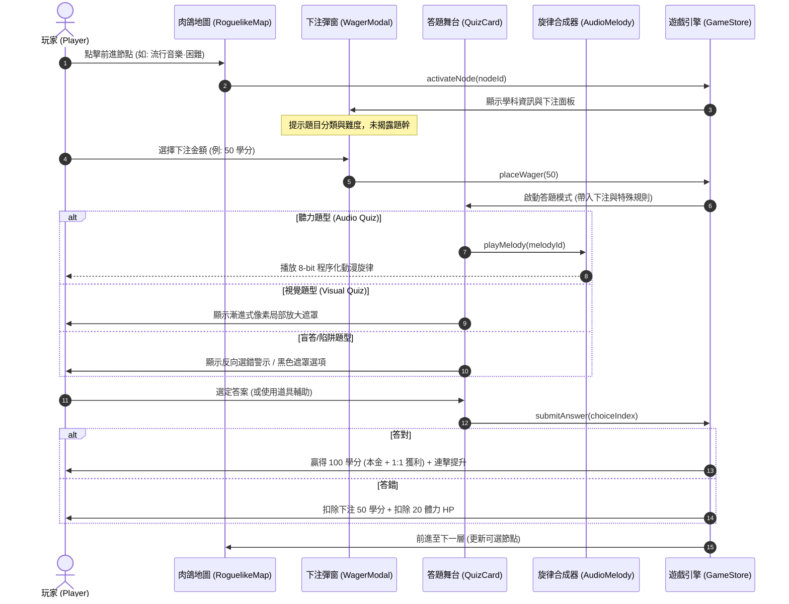
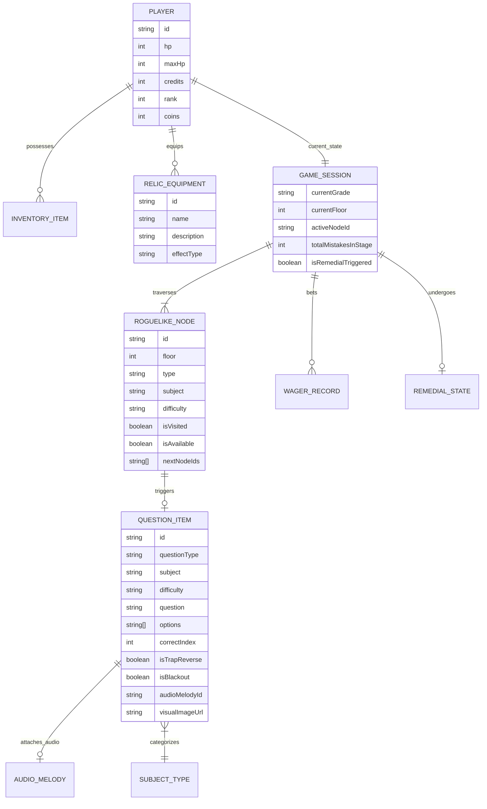

# 《民國教育委員會 2026》現代化升級規格書 (spec.md)

## 1. 專案概述 (Project Overview)
本專案為致敬 1993 年台灣大型電玩街機（Arcade）名作《民國教育委員會》之現代化 Web 復刻升級版。在保留街機復古美學（8-bit 音效、CRT 掃描線、雙主播新聞過場、師生黑板對決）的基礎上，全面導入**現代數位遊戲化機制（Gamification）**：
1. **現代化動態題型與博弈機制**：聽力猜歌猜台詞、視覺局部放大辨識、手速搶答、反向選錯陷阱題、盲答迷霧題，以及答題前「即時信心下注（Wagering）」。
2. **輕度 Roguelike 樹狀分支地圖 (Slay the Spire 架構)**：告別純擲骰看運氣的拖沓節奏，改為透明可視的樹狀節點路線，玩家可依自身學科強項與血量規劃通關路徑。
3. **校園「留級／重修補考」機制**：答錯率過高時強制觸發期中補考，通過考驗可獲得稀有被動聖物裝備（如作弊小抄、免死金牌）。

---

## 2. 技術選型 (Tech Stack)
* **核心框架**：Vue 3 (Composition API with `<script setup>`) + TypeScript
* **建置工具**：Vite 6
* **樣式與主題**：Tailwind CSS (自訂 Retro Arcade 調色盤、CRT 掃描線、動態發光特效)
* **狀態管理**：Pinia
* **多媒體與音效模組**：Web Audio API 程序化合成器（8-bit 音階旋律產生器，支援離線即時合成動漫歌與廣告旋律）
* **資料持久化**：瀏覽器 LocalStorage（無伺服器架構，保存自訂題庫、歷史戰績、人物形象設定）
* **視覺特效**：Canvas Confetti (通關撒花)、SVG 貝茲曲線動態路徑繪製

---

## 3. 系統流程圖與狀態機 (UML Diagrams)

### 3.1 Roguelike 地圖與現代化答題主流程圖 (Flowchart)
```mermaid
flowchart TD
    Start([啟動遊戲 / 投幣]) --> Title[街機標題畫面]
    Title --> SelectMode{地圖模式選擇}

    SelectMode -->|輕度肉鴿模式 (推薦)| InitRogue[產生 Roguelike 樹狀節點地圖]
    SelectMode -->|經典街機模式| InitClassic[初始化傳統卡匣軌道]

    InitRogue --> ViewMap[檢視本層可選節點路線]
    ViewMap --> PickNode[玩家自主挑選前進節點]

    PickNode --> NodeTypeCheck{節點類型判定}
    NodeTypeCheck -->|學科考題| WagerPhase[即時信心下注階段]
    NodeTypeCheck -->|聽力猜歌| AudioQuiz[8-bit 懷舊旋律聽力題]
    NodeTypeCheck -->|視覺謎題| VisualQuiz[局部放大照片辨識]
    NodeTypeCheck -->|福利社補給| ShopModal[福利社購買道具與裝備]
    NodeTypeCheck -->|突發事件| EventModal[校園命運事件]
    NodeTypeCheck -->|期末終點| BossExam[升學大考 Boss 檢定]

    WagerPhase --> RevealQuiz[揭露題目與特殊規則: 陷阱/盲答/雙倍]
    RevealQuiz --> PlayerAnswer[玩家限時作答]
    AudioQuiz --> PlayerAnswer
    VisualQuiz --> PlayerAnswer

    PlayerAnswer --> SettleAnswer{答案判定}
    SettleAnswer -->|答對| RewardWin[結算: 下注獲利加倍 + 體力維持 + Rank提升]
    SettleAnswer -->|答錯| PenaltyLoss[結算: 下注歸零 + 體力扣除 + 記錄失誤]

    RewardWin --> RetentionCheck{本學程累積失誤 >= 3 題?}
    PenaltyLoss --> RetentionCheck

    RetentionCheck -->|是| TriggerRemedial[觸發: 教官留級警告 & 期中補考]
    RetentionCheck -->|否| CheckHp{體力 HP > 0?}

    TriggerRemedial --> RemedialExam[期中補考考驗: 連續答對3題]
    RemedialExam -->|補考通過| RemedialPass[獲取特殊聖物裝備 + 危機解除]
    RemedialExam -->|補考失敗| RemedialFail[降級留級 / 扣除續關代幣]
    RemedialPass --> CheckHp
    RemedialFail --> CheckHp

    CheckHp -->|體力耗盡| ContinueScreen[9秒投幣續關畫面]
    ContinueScreen -->|投幣續關| Revive[滿血復活繼續闖關]
    ContinueScreen -->|放棄| Summary[結算成績單]

    CheckHp -->|體力存續| FloorFinish{到達本學程頂層?}
    FloorFinish -->|未達頂層| ViewMap
    FloorFinish -->|已達頂層| BossExam

    BossExam --> BossResult{大考檢定通過?}
    BossResult -->|通過| GraduateStage[晉級下一個學程: 國中 -> 高中 -> 大學]
    BossResult -->|失敗| ContinueScreen
    GraduateStage --> Victory[光榮畢業典禮]
```

---

### 3.2 信心下注與動態題型循序圖 (Sequence Diagram)


---

### 3.3 系統實體關聯圖 (ER Diagram)


---

## 4. 模組規格詳細設計

### 4.1 核心答題機制的現代化改良 (Gamification)
1. **即時信心下注 (Confidence Wagering)**：
   * **觸發時機**：進入學科考題節點時，題幹暫不顯示，僅顯示學科（例：社會、流行音樂）與難易度標籤。
   * **下注檔次**：
     * `不下注 (0 學分)`：保本模式，答對獲得基礎獎勵。
     * `小賭怡情 (20 學分)`：1.5 倍學分回饋。
     * `重注博弈 (50 學分)`：2.0 倍學分回饋。
     * `孤注一擲 (All-In)`：投注目前所有學分（上限 200），3.0 倍獲利！
   * **答錯懲處**：賠光下注額；若下注超過 50 且答錯，額外扣除 10 點體力。

2. **多樣動態題型 (Dynamic Quiz Modes)**：
   * **聽力題 (Audio Quiz)**：
     * 呼叫 [`src/utils/audioMelodySynthesizer.ts`](file:///C:/Users/rossiyeh/SegaProjectHub/quiz/src/utils/audioMelodySynthesizer.ts)。
     * 使用 Web Audio API 即時合成 8-bit 音頻。
     * 內建 10+ 首台灣懷舊旋律（例如：《無敵鐵金剛》、《灌籃高手》、《小虎隊·青蘋果樂園》、《大同電鍋主題歌》、《斯斯感冒膠囊》）。
     * 提供「▶ 重播旋律」按鈕。
   * **視覺題 (Visual Zoom Quiz)**：
     * 展示局部放大圖片或馬賽克遮罩。
     * 隨著計時器減少，馬賽克程度逐步減輕，考驗敏銳辨識力。
   * **陷阱題與盲答機制 (Traps & Blackout)**：
     * **反向題**：題幹附帶紅色警報霓虹閃爍，要求選出「非正確／錯誤」的敘述。
     * **雙倍傷害 (Double Trouble)**：答錯體力扣除 40 點。
     * **盲答迷霧 (Blackout)**：四個選項被黑霧覆蓋，玩家可花費 15 學分揭開，或直接盲點（盲點答對加倍得分）。

---

### 4.2 Slay the Spire 式 Roguelike 樹狀節點地圖 (Node-based Map)
1. **地圖架構**：
   * 每一個學程（國小、國中、高中、大學）生成一個獨立的樹狀路線圖。
   * 共包含 **8~10 個樓層 (Floors)**，每層由 2~3 個可選節點構成。
   * 節點之間由貝茲曲線（SVG Cubic Bezier Curves）連接，可選節點呈現呼吸霓虹發光，已通過節點變灰。
2. **節點類型**：
   * `QUIZ_NORMAL`：一般隨堂考（普通題型，平穩獎勵）。
   * `QUIZ_ELITE`：菁英挑戰題（高難度，但必掉落大額學分或被動道具）。
   * `AUDIO_EVENT`：懷舊聽力題節點。
   * `VISUAL_EVENT`：視覺局部放大解謎節點。
   * `CANTEEN_REST`：校園福利社（可花費學分購買道具、吃點心回復 HP）。
   * `CAMPUS_FATE`：隨機校園事件（奇遇、不良少年、校長獎勵、抽籤）。
   * `FINAL_EXAM`：頂樓期末升學檢定大考 (Boss 戰)。

---

### 4.3 留級與期中重修補考機制 (Remedial Exam & Retention)
1. **觸發條件**：
   * 在單一學程內，若答錯累計達 **3 題**，或體力掉落至 **25% 以下**，在進入下一層時將強制跳出「教務處留級通告」與「期中補考」。
2. **補考規則**：
   * 玩家必須在有限時間內連續答對 **3 道** 題目。
   * 補考期間禁止使用背包常規道具。
3. **補考結算**：
   * **通過補考**：危機解除，體力補回 50 點，並獲得**稀有校園聖物裝備**（三選一）：
     * 📖 **作弊小抄 (Relic)**：之後每道題目開場自動替您剔除 1 個錯誤選項。
     * 🛡️ **免死金牌 (Relic)**：當體力歸零時，自動免死一次並回復 30 點 HP。
     * 💰 **獎學金證明 (Relic)**：每道題目答對額外獲得 +20% 學分。
   * **補考失敗**：若補考未過，強制扣除 1 枚街機代幣（Coin）留級重修當前學程。

---

## 5. 資料結構擴充定義 (TypeScript Interfaces)

```typescript
/** 題型種類 */
export type QuizQuestionType = 
  | 'STANDARD'      // 標準四選一單選
  | 'AUDIO_GUESS'   // 8-bit 聽力猜歌/猜台詞
  | 'VISUAL_ZOOM'   // 局部放大/馬賽克視覺題
  | 'TRAP_REVERSE'  // 反向選錯題
  | 'BLACKOUT';     // 盲答迷霧題

/** 下注檔次 */
export type WagerAmount = 0 | 20 | 50 | 'ALL_IN';

/** 肉鴿地圖節點類型 */
export type RoguelikeNodeType = 
  | 'QUIZ_NORMAL'
  | 'QUIZ_ELITE'
  | 'AUDIO_EVENT'
  | 'VISUAL_EVENT'
  | 'CANTEEN_REST'
  | 'CAMPUS_FATE'
  | 'FINAL_EXAM';

/** 地圖節點介面 */
export interface RoguelikeNode {
  id: string;
  floor: number;
  colIndex: number;
  type: RoguelikeNodeType;
  title: string;
  subject: SubjectType;
  difficulty: DifficultyType;
  icon: string;
  isAvailable: boolean;
  isVisited: boolean;
  nextNodeIds: string[];
}

/** 8-bit 旋律資料模型 */
export interface AudioMelodyItem {
  id: string;
  title: string;
  notes: Array<{ freq: number; duration: number }>;
}

/** 校園被動聖物裝備介面 */
export interface SchoolRelic {
  id: string;
  name: string;
  icon: string;
  description: string;
  effect: 'AUTO_REMOVE_WRONG' | 'DEATH_PREVENTION' | 'BONUS_CREDITS';
}

/** 補考即時狀態 */
export interface RemedialExamState {
  isActive: boolean;
  currentStreak: number;
  requiredStreak: number;
  timeRemaining: number;
}
```
