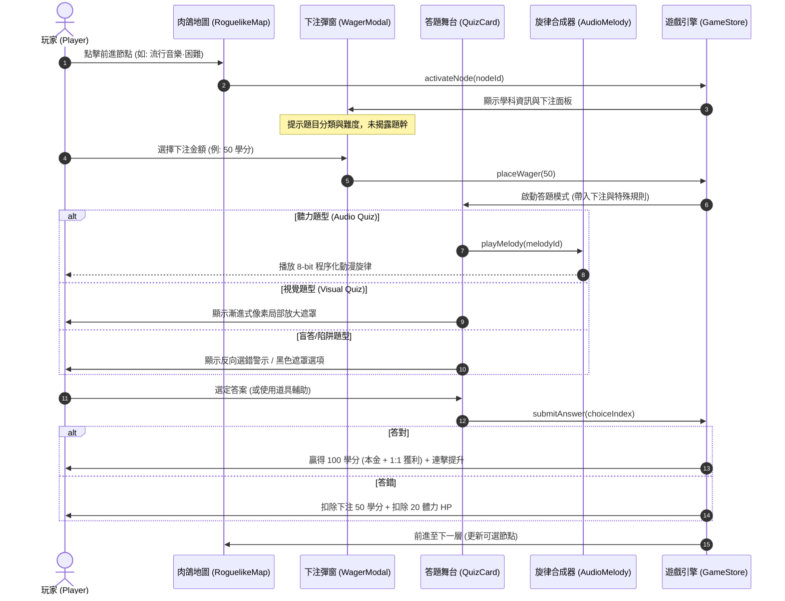
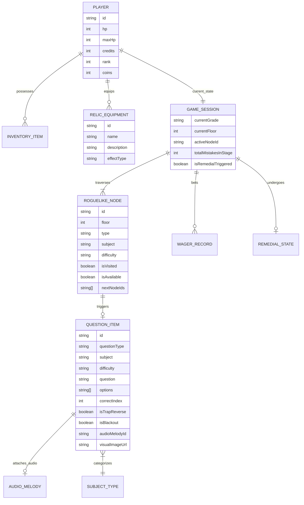
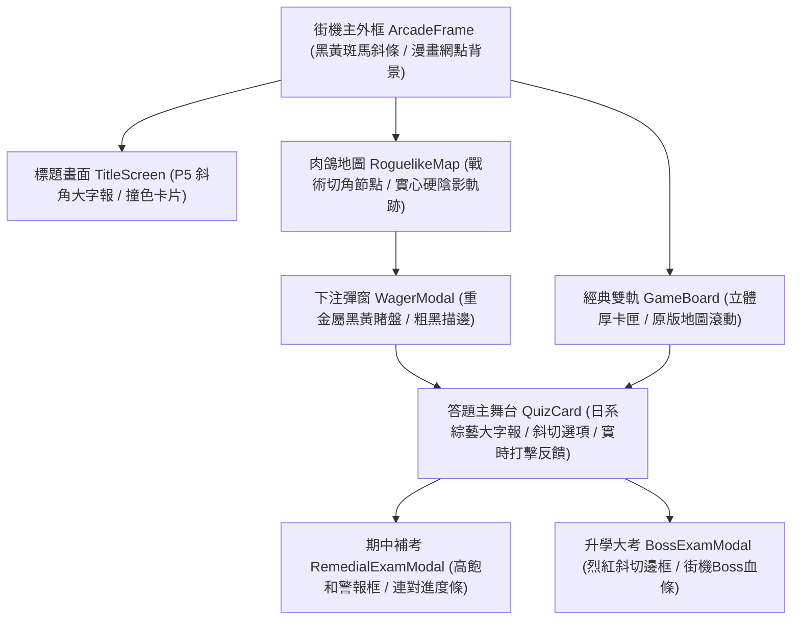
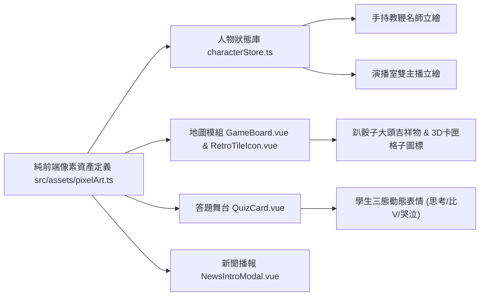
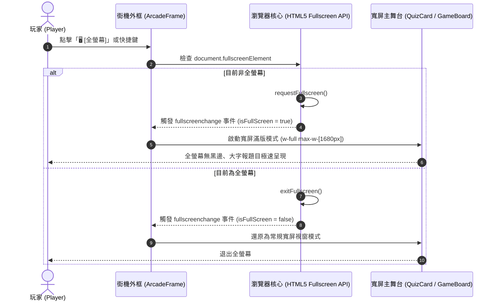

# 《民國教育委員會 2026》現代化升級規格書 (spec.md)

## 1. 專案概述 (Project Overview)
本專案為致敬 1993 年台灣大型電玩街機（Arcade）名作《民國教育委員會》之現代化 Web 復刻升級版。在保留街機復古美學（8-bit 音效、CRT 掃描線、雙主播新聞過場、師生黑板對決）的基礎上，全面導入**現代數位遊戲化機制（Gamification）**：
1. **現代化動態題型與博弈機制**：聽力猜歌猜台詞、視覺局部放大辨識、手速搶答、反向選錯陷阱題、盲答迷霧題，以及答題前「即時信心下注（Wagering）」。
2. **輕度 Roguelike 樹狀分支地圖 (Slay the Spire 架構)**：告別純擲骰看運氣的拖沓節奏，改為透明可視的樹狀節點路線，玩家可依自身學科強項與血量規劃通關路徑。
3. **校園「留級／重修補考」機制**：答錯率過高時強制觸發期中補考，通過考驗可獲得稀有被動聖物裝備（如作弊小抄、免死金牌）。

---

## 2. 技術選型 (Tech Stack)
* **核心框架**：Vue 3 (Composition API with `<script setup>`) + TypeScript
* **建置工具**：Vite 6
* **樣式與主題**：Tailwind CSS (自訂 Retro Arcade 調色盤、CRT 掃描線、動態發光特效)
* **狀態管理**：Pinia
* **多媒體與音效模組**：Web Audio API 程序化合成器（8-bit 音階旋律產生器，支援離線即時合成動漫歌與廣告旋律）
* **資料持久化**：瀏覽器 LocalStorage（無伺服器架構，保存自訂題庫、歷史戰績、人物形象設定）
* **視覺特效**：Canvas Confetti (通關撒花)、SVG 貝茲曲線動態路徑繪製

---

## 3. 系統流程圖與狀態機 (UML Diagrams)

### 3.1 Roguelike 地圖與現代化答題主流程圖 (Flowchart)
```mermaid
flowchart TD
    Start([啟動遊戲 / 投幣]) --> Title[街機標題畫面]
    Title --> SelectMode{地圖模式選擇}

    SelectMode -->|輕度肉鴿模式 (推薦)| InitRogue[產生 Roguelike 樹狀節點地圖]
    SelectMode -->|經典街機模式| InitClassic[初始化傳統卡匣軌道]

    InitRogue --> ViewMap[檢視本層可選節點路線]
    ViewMap --> PickNode[玩家自主挑選前進節點]

    PickNode --> NodeTypeCheck{節點類型判定}
    NodeTypeCheck -->|學科考題| WagerPhase[即時信心下注階段]
    NodeTypeCheck -->|聽力猜歌| AudioQuiz[8-bit 懷舊旋律聽力題]
    NodeTypeCheck -->|視覺謎題| VisualQuiz[局部放大照片辨識]
    NodeTypeCheck -->|福利社補給| ShopModal[福利社購買道具與裝備]
    NodeTypeCheck -->|突發事件| EventModal[校園命運事件]
    NodeTypeCheck -->|期末終點| BossExam[升學大考 Boss 檢定]

    WagerPhase --> RevealQuiz[揭露題目與特殊規則: 陷阱/盲答/雙倍]
    RevealQuiz --> PlayerAnswer[玩家限時作答]
    AudioQuiz --> PlayerAnswer
    VisualQuiz --> PlayerAnswer

    PlayerAnswer --> SettleAnswer{答案判定}
    SettleAnswer -->|答對| RewardWin[結算: 下注獲利加倍 + 體力維持 + Rank提升]
    SettleAnswer -->|答錯| PenaltyLoss[結算: 下注歸零 + 體力扣除 + 記錄失誤]

    RewardWin --> RetentionCheck{本學程累積失誤 >= 3 題?}
    PenaltyLoss --> RetentionCheck

    RetentionCheck -->|是| TriggerRemedial[觸發: 教官留級警告 & 期中補考]
    RetentionCheck -->|否| CheckHp{體力 HP > 0?}

    TriggerRemedial --> RemedialExam[期中補考考驗: 連續答對3題]
    RemedialExam -->|補考通過| RemedialPass[獲取特殊聖物裝備 + 危機解除]
    RemedialExam -->|補考失敗| RemedialFail[降級留級 / 扣除續關代幣]
    RemedialPass --> CheckHp
    RemedialFail --> CheckHp

    CheckHp -->|體力耗盡| ContinueScreen[9秒投幣續關畫面]
    ContinueScreen -->|投幣續關| Revive[滿血復活繼續闖關]
    ContinueScreen -->|放棄| Summary[結算成績單]

    CheckHp -->|體力存續| FloorFinish{到達本學程頂層?}
    FloorFinish -->|未達頂層| ViewMap
    FloorFinish -->|已達頂層| BossExam

    BossExam --> BossResult{大考檢定通過?}
    BossResult -->|通過| GraduateStage[晉級下一個學程: 國中 -> 高中 -> 大學]
    BossResult -->|失敗| ContinueScreen
    GraduateStage --> Victory[光榮畢業典禮]
```

---

### 3.2 信心下注與動態題型循序圖 (Sequence Diagram)


---

### 3.3 系統實體關聯圖 (ER Diagram)


---

## 4. 模組規格詳細設計

### 4.1 核心答題機制的現代化改良 (Gamification)
1. **即時信心下注 (Confidence Wagering)**：
   * **觸發時機**：進入學科考題節點時，題幹暫不顯示，僅顯示學科（例：社會、流行音樂）與難易度標籤。
   * **下注檔次**：
     * `不下注 (0 學分)`：保本模式，答對獲得基礎獎勵。
     * `小賭怡情 (20 學分)`：1.5 倍學分回饋。
     * `重注博弈 (50 學分)`：2.0 倍學分回饋。
     * `孤注一擲 (All-In)`：投注目前所有學分（上限 200），3.0 倍獲利！
   * **答錯懲處**：賠光下注額；若下注超過 50 且答錯，額外扣除 10 點體力。

2. **多樣動態題型 (Dynamic Quiz Modes)**：
   * **聽力題 (Audio Quiz)**：
     * 呼叫 [`src/utils/audioMelodySynthesizer.ts`](file:///C:/Users/rossiyeh/SegaProjectHub/quiz/src/utils/audioMelodySynthesizer.ts)。
     * 使用 Web Audio API 即時合成 8-bit 音頻。
     * 內建 10+ 首台灣懷舊旋律（例如：《無敵鐵金剛》、《灌籃高手》、《小虎隊·青蘋果樂園》、《大同電鍋主題歌》、《斯斯感冒膠囊》）。
     * 提供「▶ 重播旋律」按鈕。
   * **視覺題 (Visual Zoom Quiz)**：
     * 展示局部放大圖片或馬賽克遮罩。
     * 隨著計時器減少，馬賽克程度逐步減輕，考驗敏銳辨識力。
   * **陷阱題與盲答機制 (Traps & Blackout)**：
     * **反向題**：題幹附帶紅色警報霓虹閃爍，要求選出「非正確／錯誤」的敘述。
     * **雙倍傷害 (Double Trouble)**：答錯體力扣除 40 點。
     * **盲答迷霧 (Blackout)**：四個選項被黑霧覆蓋，玩家可花費 15 學分揭開，或直接盲點（盲點答對加倍得分）。

3. **答題狀態生命週期與答案隱蔽守則 (Answer Secrecy & Lifecycle)**：
   * **彈窗嚴格互斥**：答題黑板 (`QuizCard`) 僅在 `activeModal === 'QUIZ'` 且 `currentQuestion !== null` 時渲染，嚴禁在下注階段 (`WAGER`)、地圖探索或開新局時提前浮現。
   * **狀態徹底重置**：每次開啟題目或新局，必須重置 `isAnswered = false`、`lastSelectedChoice = null`、`isLastAnswerCorrect = null`、`disabledOptionIndices = []`。
   * **答案揭露時機**：只有在玩家親自點擊選項作答後，或倒數計時歸零時，`isAnswered` 轉為 `true`，方得高亮標示「✓ 正解」與顯示「💡 名師解答」。作答前嚴禁揭露任何正解線索。

---

### 4.2 Slay the Spire 式 Roguelike 樹狀節點地圖 (Node-based Map)
1. **地圖架構**：
   * 每一個學程（國小、國中、高中、大學）生成一個獨立的樹狀路線圖。
   * 共包含 **8~10 個樓層 (Floors)**，每層由 2~3 個可選節點構成。
   * 節點之間由貝茲曲線（SVG Cubic Bezier Curves）連接，可選節點呈現呼吸霓虹發光，已通過節點變灰。
2. **節點類型**：
   * `QUIZ_NORMAL`：一般隨堂考（普通題型，平穩獎勵）。
   * `QUIZ_ELITE`：菁英挑戰題（高難度，但必掉落大額學分或被動道具）。
   * `AUDIO_EVENT`：懷舊聽力題節點。
   * `VISUAL_EVENT`：視覺局部放大解謎節點。
   * `CANTEEN_REST`：校園福利社（可花費學分購買道具、吃點心回復 HP）。
   * `CAMPUS_FATE`：隨機校園事件（奇遇、不良少年、校長獎勵、抽籤）。
   * `FINAL_EXAM`：頂樓期末升學檢定大考 (Boss 戰)。

---

### 4.3 留級與期中重修補考機制 (Remedial Exam & Retention)
1. **觸發條件**：
   * 在單一學程內，若答錯累計達 **3 題**，或體力掉落至 **25% 以下**，在進入下一層時將強制跳出「教務處留級通告」與「期中補考」。
2. **補考規則**：
   * 玩家必須在有限時間內連續答對 **3 道** 題目。
   * 補考期間禁止使用背包常規道具。
3. **補考結算**：
   * **通過補考**：危機解除，體力補回 50 點，並獲得**稀有校園聖物裝備**（三選一）：
     * 📖 **作弊小抄 (Relic)**：之後每道題目開場自動替您剔除 1 個錯誤選項。
     * 🛡️ **免死金牌 (Relic)**：當體力歸零時，自動免死一次並回復 30 點 HP。
     * 💰 **獎學金證明 (Relic)**：每道題目答對額外獲得 +20% 學分。
   * **補考失敗**：若補考未過，強制扣除 1 枚街機代幣（Coin）留級重修當前學程。

---

## 5. 資料結構擴充定義 (TypeScript Interfaces)

```typescript
/** 題型種類 */
export type QuizQuestionType = 
  | 'STANDARD'      // 標準四選一單選
  | 'AUDIO_GUESS'   // 8-bit 聽力猜歌/猜台詞
  | 'VISUAL_ZOOM'   // 局部放大/馬賽克視覺題
  | 'TRAP_REVERSE'  // 反向選錯題
  | 'BLACKOUT';     // 盲答迷霧題

/** 下注檔次 */
export type WagerAmount = 0 | 20 | 50 | 'ALL_IN';

/** 肉鴿地圖節點類型 */
export type RoguelikeNodeType = 
  | 'QUIZ_NORMAL'
  | 'QUIZ_ELITE'
  | 'AUDIO_EVENT'
  | 'VISUAL_EVENT'
  | 'CANTEEN_REST'
  | 'CAMPUS_FATE'
  | 'FINAL_EXAM';

/** 地圖節點介面 */
export interface RoguelikeNode {
  id: string;
  floor: number;
  colIndex: number;
  type: RoguelikeNodeType;
  title: string;
  subject: SubjectType;
  difficulty: DifficultyType;
  icon: string;
  isAvailable: boolean;
  isVisited: boolean;
  nextNodeIds: string[];
}

/** 8-bit 旋律資料模型 */
export interface AudioMelodyItem {
  id: string;
  title: string;
  notes: Array<{ freq: number; duration: number }>;
}

/** 校園被動聖物裝備介面 */
export interface SchoolRelic {
  id: string;
  name: string;
  icon: string;
  description: string;
  effect: 'AUTO_REMOVE_WRONG' | 'DEATH_PREVENTION' | 'BONUS_CREDITS';
}

/** 補考即時狀態 */
export interface RemedialExamState {
  isActive: boolean;
  currentStreak: number;
  requiredStreak: number;
  timeRemaining: number;
}
```

---

## 6. 日系新潮街機撞色風 (Neo-Arcade Stylized) 視覺系統規格

### 6.1 去 AI 化 (De-AI) 設計理念與色彩體系
徹底摒除現代 Web3/AI 常見之死板深藍紫漸層（Tailwind slate-900 / indigo-950）、柔和毛玻璃（backdrop-blur）與圓潤膠囊圓角（rounded-3xl），全面引進日系大型街機（如《Persona 5》/《Street Fighter 6》）之高張力撞色與動漫幾何美學：

1. **核心配色盤 (Neo-Arcade Palette)**：
   * **警戒銘黃 (`#FFE600`)**：高對比主色，用於重要標題、按鈕、當前節點與關鍵倒數。
   * **曜石深墨黑 (`#090B10` / `#050608`)**：深邃底色，取代發灰的 slate-900。
   * **警示烈紅 (`#FF0055`)**：用於危急扣血、陷阱題、Boss 戰與倒數 3 秒。
   * **普魯士黑藍 (`#0A1224`)**：用於答題黑板內襯與深色模塊。
   * **電光青碧 (`#00F0FF`)**：用於學科標籤與科技線條。
   * **極限狂熱紫 (`#BD00FF`)**：用於盲答迷霧與特殊菁英考驗。
2. **幾何切割與質感紋理 (Brutal Geometry & Textures)**：
   * **日系戰術斜切角 (Chamfered Corners)**：使用 CSS `clip-path: polygon(...)` 實現 45° 與 15° 幾何切角，全面取代 rounded 圓角。
   * **美漫/日漫半色調網點 (Halftone Comic Dots)**：背景採用 SVG 幾何波點網紋，強化街機印刷感。
   * **警戒斑馬斜條紋 (Hazard Stripes)**：在視窗頂部與下注區域採用黑黃相間 45° 警戒紋理。
   * **硬實心陰影 (Hard Drop Shadows)**：採用 `box-shadow: 4px 4px 0px #000000`，按鍵按下時位移 `translate(4px, 4px)` 並消除陰影，產生無延遲的街機實體微動按鈕打擊感。
3. **符號去 Emoji 化**：
   * 全面淘汰現代手機 Emoji，改以專屬 SVG 像素標章與日系大字報標籤（如 `[NODE]`, `[ELITE]`, `[REST]`, `[EXAM]`）呈現。

### 6.2 視覺組件架構圖 (Mermaid UI Topology)


---

## 7. 16-Bit 大型街機手繪像素點陣畫資產規格 (Pixel Art Assets Spec)

### 7.1 人物立繪規格 (致敬 `pic/quiz1.jpg` & `pic/new1.jpg`)
1. **督學名師 (Strict Master Teacher)**：
   * 100% 依據 `pic/quiz1.jpg` 復刻：深色西裝、立領白襯衫、暗紅領帶、手持木質金屬教鞭。
   * 精緻黑框眼鏡、反光鏡片與嚴肅抿嘴神態，呈現 90 年代升學補習班名師霸氣。
2. **考生代表學生 (Student Mascot)**：
   * 依據 `pic/quiz1.jpg` 左側學生重繪，具備三態高精度像素表情動態：
     * **思考態 (Thinking)**：托腮沉思、靈動眼神。
     * **答對態 (Correct)**：瞇瞇眼大笑、雙手比 V、開心跳躍。
     * **答錯態 (Wrong)**：淚流滿面、抱頭痛哭、汗滴滑落。
3. **時事雙主播 (News Anchors)**：
   * 依據 `pic/new1.jpg` 復刻：
     * **左女主播**：90 年代波浪吹高髮型、寶藍色套裝、珍珠耳環與播報手勢。
     * **右男主播**：經典圓臉、張大嘴巴、圓鼻子的名嘴滑稽神韻。
4. **歷史與軍訓名師 (Confucius, Einstein, Military)**：
   * 全數採用同等 16-bit 像素手繪重製，徹底淘汰粗糙 placeholder。

### 7.2 地圖美術資產規格 (致敬 `pic/地圖.jpg` & `pic/map1.jpg`)
1. **地圖上半部校舍與吉祥物骰子**：
   * **經典吉祥物**：大頭吉祥物趴在深藍立體方塊骰子上（還原 `pic/地圖.jpg`）。
   * **像素校舍背景**：雙層鐘樓校舍、紅瓦排窗、綠蔭遠山與藍天白雲。
2. **立體雙軌卡匣軌道圖標**：
   * **START**：小學生書包。
   * **TROUBLE**：精緻白色骷髏骨與紫色災難毒氣（致敬 `pic/map1.jpg`）。
   * **三選一**：立體藍底白色「三選一」大字牌。
   * **天才問題**：紅底白字立體金邊字。
   * **健康教育**：經典心型解剖紅心圖標。
   * **各學科**：國文古籍、地理地球儀、自然燒杯量筒、數學三角圓規。

### 7.3 美術資產管線流程圖 (Pipeline Diagram)


---

## 8. 電腦版寬屏全畫面與全域字級階層規範 (Desktop Wide & Large Font Spec)

### 8.1 寬屏機台架構與原生全螢幕機制 (Fullscreen & Wide Canvas)
1. **框體寬度解除上限**：
   * 原架構 `max-w-5xl`（1024px）擴展為寬屏自適應模式（`w-full max-w-[1536px] 2xl:max-w-[1680px]`），填滿 1080p、2K 與 4K 螢幕兩側留白。
   * 保留頂部黑黃斑馬紋警戒條與 Neo-Arcade 戰術幾何切角。
2. **HTML5 Fullscreen API 整合**：
   * 在頂部導航燈箱新增 `🖥️ [全螢幕 FULLSCREEN]` 實體街機微動開關。
   * 支援 `document.fullscreenElement` 檢測與 `requestFullscreen()` / `exitFullscreen()`。
   * 玩家按下 ESC 或點擊按鍵時即時雙向同步開關狀態。

### 8.2 全域字級階梯規範 (Typography Hierarchy)

| 介面元件 | 原版字級 | 寬屏放大升級字級 | Tailwind 規範類別 | 備註說明 |
| :--- | :--- | :--- | :--- | :--- |
| **題目題幹文字** | 14px~16px | **22px ~ 26px** | `text-xl sm:text-2xl font-black` | 黑板大字報粗體，高對比黃字 |
| **四選一選項文字** | 12px~14px | **16px ~ 19px** | `text-base sm:text-lg font-bold` | 按鈕高度增至 56px+，點擊熱區擴大 |
| **雙軌地圖卡匣標籤** | 8px~10px | **12px ~ 14px** | `text-xs sm:text-sm font-black` | 3D 卡匣厚度與像素圖標等比放大 |
| **肉鴿地圖節點標籤** | 9px~10px | **12px ~ 14px** | `text-xs sm:text-sm font-black` | 節點按鈕寬度增至 130px~150px |
| **HUD 狀態列數值** | 12px | **15px ~ 18px** | `text-sm sm:text-base font-black` | HP 條增厚、分數與學分一目了然 |
| **主持評論跑馬燈** | 12px | **14px ~ 16px** | `text-sm sm:text-base font-bold` | 播報橫幅醒目清晰 |
| **操作功能按鍵** | 11px~12px | **14px ~ 16px** | `text-sm font-black py-2 px-4` | 擲骰 (SPACE) 與道具欄大幅擴大 |

### 8.3 寬屏佈局與全螢幕切換循序圖 (Sequence Diagram)



---

## 10. 「五關速通賽 vs 十關馬拉松」關卡長度自選系統規格 (Game Length Selection Spec)

### 10.1 模式定位與設計理念
為滿足不同場景與玩家節奏偏好，於開局首頁與遊戲中提供「五關速通賽」與「十關馬拉松」雙長度自選機制：

1. **⚡ 五關速通賽 (`GameLengthMode = 5`)**：
   * **適用場景**：碎片時間、快速單局試玩、課堂即時測驗競賽（約 3~5 分鐘通關）。
   * **肉鴿地圖樓層**：精縮為 5 個樓層（Floor 0 開學檢定 ➔ Floor 1 雙軌初試 ➔ Floor 2 聽力/視覺特考 ➔ Floor 3 福利社/奇遇補給 ➔ Floor 4 升學大考 Boss 戰）。
   * **經典雙軌棋盤**：精縮為 5 步關鍵節點（起點 ➔ 路線分叉 ➔ 2 關學科卡匣 ➔ 升學 Boss 終點），跑馬燈同步顯示「離畢業還有 5 層次」。
2. **🏆 十關馬拉松 (`GameLengthMode = 10`)**：
   * **適用場景**：完整沉浸、深度修煉、挑戰全學科與被動聖物（約 8~12 分鐘通關）。
   * **肉鴿地圖樓層**：展開為完整 10 個樓層（Floor 0~9），涵蓋隨堂考、菁英考、聽力猜歌、局部照片、多次福利社與留級補考機制。
   * **經典雙軌棋盤**：完整雙軌長軌道，還原大型街機「離畢業還有 10 層次」。

### 10.2 資料結構與參數對照表

```typescript
/** 關卡長度模式 */
export type GameLengthMode = 5 | 10;
```

| 關卡長度模式 | 肉鴿地圖總樓層 | 經典棋盤總格數 | 預估通關時間 | Boss 戰出現時機 | 跑馬燈標語 |
| :--- | :--- | :--- | :--- | :--- | :--- |
| **⚡ 5 關速通賽** | 5 層 (Floor 0~4) | 5 步關鍵節點 | 3 ~ 5 分鐘 | 第 5 關 (Floor 4) | // 離畢業還有 5 層次。 // |
| **🏆 10 關馬拉松** | 10 層 (Floor 0~9) | 12~14 步完整雙軌 | 8 ~ 12 分鐘 | 第 10 關 (Floor 9) | // 離畢業還有 10 層次。 // |

### 10.3 關卡長度切換與地圖生成循序圖 (Sequence Diagram)
```mermaid
sequenceDiagram
    autonumber
    actor Player as 玩家 (Player)
    participant Title as 標題首頁 (TitleScreen)
    participant Store as 遊戲狀態庫 (gameStore)
    participant GenRogue as 肉鴿生成器 (roguelikeGenerator)
    participant GenBoard as 棋盤生成器 (boardGenerator)

    Player->>Title: 點擊切換 [⚡ 5關速通 / 🏆 10關馬拉松]
    Title->>Store: setGameLength(5 或 10)
    Store-->>Title: 播放切換音效，高亮選中狀態按鈕
    Player->>Title: 點選模式 (如：輕度肉鴿選路)
    Title->>Store: startNewGame('國小' 或 '高中')
    alt 肉鴿模式
        Store->>GenRogue: generateRoguelikeMap(stage, gameLength)
        GenRogue-->>Store: 返回 5 層或 10 層之動態分支節點網絡
    else 經典模式
        Store->>GenBoard: generateBoardTiles(stage, gameLength)
        GenBoard-->>Store: 返回 5 步或 10 步之雙軌卡匣軌道
    end
    Store-->>Player: 進入對應長度之地圖，開始闖關！
```
