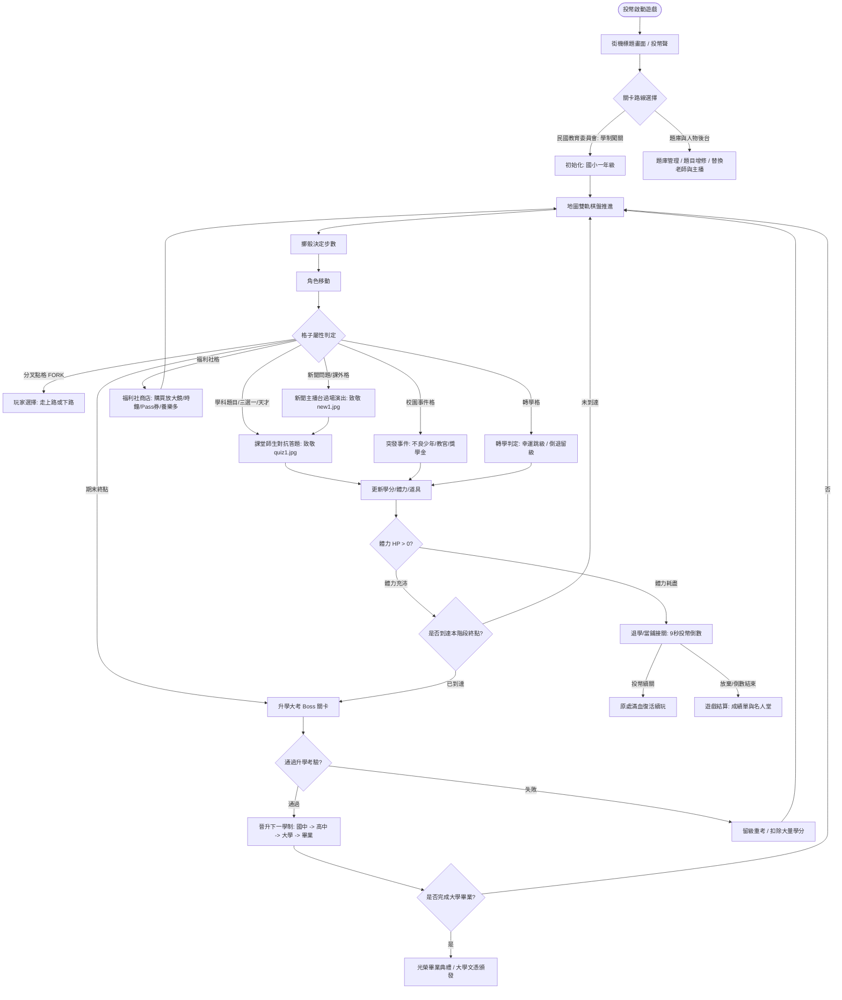

# 《民國教育委員會》復刻古街機問答遊戲 — 系統規格書 (spec.md)

## 1. 專案概述 (Project Overview)
本專案為致敬 1993 年台灣大型電玩街機（Arcade）名作《民國教育委員會》（Quiz Channel Quest）之現代化 Web 復刻版。結合「大富翁棋盤探索」與「台灣在地文化綜合升學問答」，融合高度擬真的街機數值節奏感（投幣率控制、升學 Boss 戰、Rank 動態難度、福利社道具庫存與跳級轉學機制），並具備 Excel/CSV/JSON 題庫自訂與擴充能力。

---

## 2. 技術選型 (Tech Stack)
* **核心框架**：Vue 3 (Composition API with `<script setup>`) + TypeScript
* **建置工具**：Vite
* **樣式與主題**：Tailwind CSS + 街機像素復古風格（CRT 掃描線濾鏡、像素字體、街機機台外框、霓虹看板）
* **狀態管理**：Pinia
* **資料處理與試算表解析**：`xlsx` (SheetJS) 支援 Excel 讀寫、自訂 CSV 解析器
* **音效模組**：Web Audio API 程序化合成音效（8-bit Retro Arcade Sound Generator，免載大音檔，零延遲）
* **資料儲存**：瀏覽器 LocalStorage（離線持久化玩家自訂題庫、最高分數與人物設定）

---

## 3. 核心遊戲機制與架構設計

### 3.1 遊戲主流程圖 (Game Flowchart)


---

## 4. 街機原創橫向卷軸與雙軌分叉路線 (致敬 `pic/地圖.jpg` 與 `pic/map1.jpg`)

依據 1993 年街機原始截圖，地圖界面結構劃分為三大區塊：
1. **頂部黑底紅框燈箱**：忠實重現「離畢業還有 10 層次。」跑馬燈，隨進度動態倒數。
2. **雙軌拓撲與分叉選擇**：
   * 起點設有「昇學」大方塊與「FORK 路線分叉點」，抵達時彈出路線抉擇（支援按鍵 1 / 2 或 ↑ / ↓ 快速切換）。
   * **上路線 (理科冒險)**：理化、音樂、三選一送分格、LUCKY 福利社、TROUBLE 骷髏危險格。
   * **下路線 (文藝挑戰)**：健康教育 (+25 HP 回血)、美術、天才問題 (高難度雙倍得分與學分)、問號事件、課外時事大百科。
3. **終點匯流**：上下兩路走完後重新匯集於「升學檢定大考 (Boss 戰)」。

---

## 5. 答題人物視覺系統 (致敬 `pic/quiz1.jpg` 與 `pic/new1.jpg`)

### 5.1 課堂答題師生對決舞台 (致敬 `pic/quiz1.jpg`)
* **背景與舞台**：
  * 上方標記「民國教育委員會」匾額與當前累積得分。
  * 中央設置藍色大黑板（展示題目與選項 1, 2, 3 或 1, 2, 3, 4）。
* **左側學生（固定角色）**：
  * 經典街機大頭學生漫畫人物，身穿校園制服。
  * 具備表情狀態切換：
    * 思考中（摸下巴專注）
    * 答對（比出勝利 V 手勢、雙眼發光）
    * 答錯（抱頭痛哭、流眼淚特效）
* **右側老師（支援自由替換）**：
  * 手持教鞭之授課老師。
  * **內建預設名師清單**：
    1. 嚴肅眼鏡教鞭名師（經典街機原版）
    2. 至聖先師孔子（國文名師）
    3. 愛因斯坦博士（科學名師）
    4. 嚴厲教官／訓導主任
  * **自訂老師支援**：使用者可在後台自訂「老師姓名、頭銜、頭像圖片 URL 或上傳圖片」。

### 5.2 新聞問題主播台過場演出 (致敬 `pic/new1.jpg`)
* **背景與主播台**：
  * 世界地圖藍色像素網格底圖，中間立體金屬大字「新聞問題」。
  * 前方為現代新聞主播台。
* **主播雙人搭檔（支援自由替換）**：
  * 左側：當家資深女主播（頭像可替換）。
  * 右側：滑稽幽默名嘴主播（頭像可替換）。
  * 使用者可在後台隨意替換為名人、朋友或自訂圖片！

---

## 6. 資料結構定義更新 (TypeScript Interfaces)

```typescript
export type BranchType = 'MAIN' | 'UPPER' | 'LOWER';

/** 老師角色設定介面 */
export interface TeacherProfile {
  id: string;
  name: string;
  title: string;
  avatarUrl: string;
  isCustom?: boolean;
}

/** 新聞主播設定介面 */
export interface AnchorProfile {
  id: string;
  leftAnchorName: string;
  leftAnchorAvatar: string;
  rightAnchorName: string;
  rightAnchorAvatar: string;
  isCustom?: boolean;
}
```
